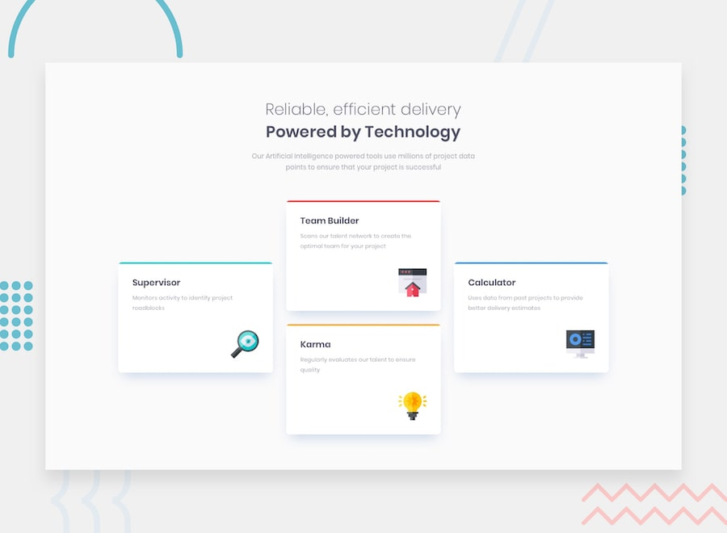

# Frontend Mentor - Four card feature section solution



This is a solution to the [Four card feature section challenge on Frontend Mentor](https://www.frontendmentor.io/challenges/four-card-feature-section-weK1eFYK). Frontend Mentor challenges help you improve your coding skills by building realistic projects.

## Table of contents

- [Overview](#overview)
  - [The challenge](#the-challenge)
  - [Links](#links)
- [My process](#my-process)
  - [Built with](#built-with)
  - [What I learned](#what-i-learned)
- [Author](#author)

## Overview

### The challenge

Your challenge is to build out this four card feature section and get it looking as close to the design as possible.

You can use any tools you like to help you complete the challenge. So if you've got something you'd like to practice, feel free to give it a go.

Your users should be able to:

- View the optimal layout depending on their device's screen size (mobile, tablet or desktop)

### Links

- Live Site URL: [github pages](https://gerardocianciulli.github.io/four-card-feature-section/)

## My process

### Built with

- Semantic HTML5 markup
- CSS custom properties
- CSS Grid with `grid-template-areas`
- Flexbox
- React
- Typescript
- Vite
- Media Queries
- [Fontsource](https://fontsource.org/) for self-hosted Poppins

### What I learned

I learned how to use CSS Grid `grid-template-areas` to build the staggered desktop layout, with the Supervisor and Calculator cards centred between the two cards in the middle column. Because each card is assigned to a named area, the media queries only redraw the grid map: the HTML stays in reading order, and no card is moved in the markup.

```css
.features__list {
  display: grid;
  grid-template-columns: repeat(3, 350px);
  grid-template-areas:
    'supervisor team-builder calculator'
    'supervisor karma        calculator';
  gap: 32px;
  align-items: center;
}

/* Tablet: four half-width tracks, so single cards sit centred */
@media (max-width: 1160px) {
  .features__list {
    grid-template-columns: repeat(4, 141px);
    grid-template-areas:
      '.            supervisor   supervisor .'
      'team-builder team-builder karma      karma'
      '.            calculator   calculator .';
  }
}
```

I also kept the cards data-driven with Typescript. A single `Feature` type describes each card, and `Omit` lets the card component reuse it without the `id`, which is only used for the React key and the grid area class.

```tsx
export type Feature = {
  id: 'supervisor' | 'team-builder' | 'karma' | 'calculator'
  title: string
  description: string
  icon: string
  accent: 'cyan' | 'red' | 'orange' | 'blue'
}

type FeatureCardProps = Omit<Feature, 'id'> & { className?: string }

{features.map(({ id, ...feature }) => (
  <FeatureCard key={id} {...feature} className={`features__item--${id}`} />
))}
```

## Author

- Portfolio - [Gerardo Cianciulli](https://www.behance.net/gerardo-cianciulli)
- Frontend Mentor - [Gerardo Cianciulli](https://www.frontendmentor.io/profile/GerardoCianciulli)
- Linkedin - [Gerardo Cianciulli](https://www.linkedin.com/in/gerardo-cianciulli/)
